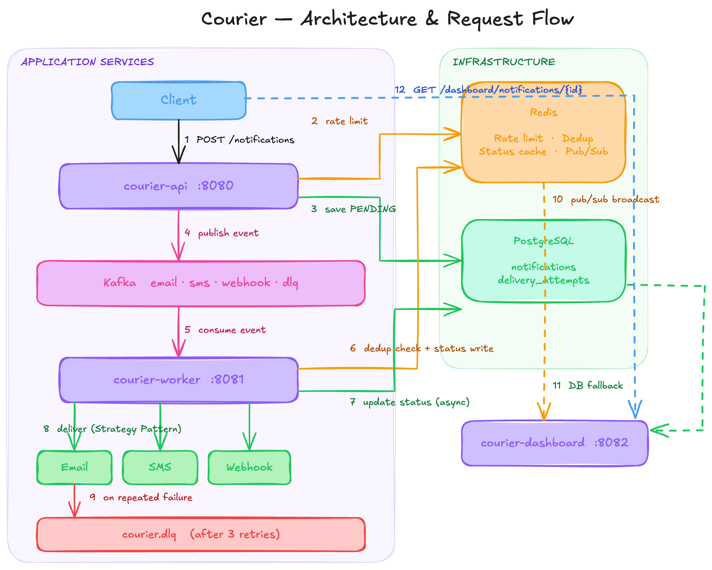

## Overview

[](https://github.com/pranay1498/courier/actions/workflows/ci.yml)

Courier is a distributed multi-channel notification delivery platform built with Spring Boot, Apache Kafka, Redis, and PostgreSQL that guarantees at-least-once delivery across Email, SMS, and Webhook channels with idempotent processing via Redis SETNX deduplication.

## Architecture


## Tech Stack
| Technology | Version | Usage |
|---|---|---|
| Spring Boot | 3.2.0 | REST API, dependency injection, Kafka integration |
| Apache Kafka | 7.6.0 (Confluent) | Async event streaming, at-least-once delivery, DLQ |
| Redis | 7 | Rate limiting (Sorted Sets + Lua), deduplication (SETNX), status cache (Hash), Pub/Sub broadcast |
| PostgreSQL | 15 | Persistent notification records, delivery attempt history |
| Docker Compose | - | Single-command local environment |
| Micrometer + Prometheus | - | Delivery counters and latency percentiles |
| Springdoc OpenAPI | 2.3.0 | Auto-generated Swagger UI |
| Testcontainers | 1.19.3 | Redis integration tests against real Redis |


## Getting Started

### Prerequisites
- Docker Desktop
- Java 21
- Maven 3.8+

### Run everything with one command

```bash
git clone https://github.com/pranay/courier.git
cd courier
mvn clean package -DskipTests
docker-compose up -d
```

Wait ~30 seconds for all services to start, then send your first notification:

```bash
curl -X POST http://localhost:8080/api/v1/notifications \
  -H "Content-Type: application/json" \
  -d '{
    "correlationId": "my-first-notification",
    "channel": "WEBHOOK",
    "recipient": "https://webhook.site/your-unique-url",
    "content": "Hello from Courier"
  }'
```

Swagger UI available at:
- courier-api: http://localhost:8080/swagger-ui.html
- courier-dashboard: http://localhost:8082/swagger-ui.html


## API Reference

### courier-api (port 8080)
| Method | Endpoint | Description |
|---|---|---|
| POST | /api/v1/notifications | Submit a notification for delivery |
| GET | /api/v1/notifications/{id}/status | Get notification status (DB read) |
| POST | /api/v1/admin/notifications/{id}/replay | Replay a DLQ'd notification |

### courier-dashboard (port 8082)
| Method | Endpoint | Description |
|---|---|---|
| GET | /api/v1/dashboard/notifications/{id} | Get status (Redis-backed) |
| GET | /api/v1/dashboard/notifications/{id}/attempts | Get delivery attempt history |
| GET | /api/v1/dashboard/notifications | Paginated listing with filters |
| GET | /api/v1/dashboard/stats | Delivery statistics per channel |


## Project Structure

```
courier/
├── courier-common/          # Shared entities, DTOs, repositories
├── courier-api/             # REST API - submission and routing (port 8080)
├── courier-worker/          # Kafka consumer - delivery engine (port 8081)
├── courier-dashboard/       # Read API - status and statistics (port 8082)
├── docker-compose.yml       # Full system: Kafka, Redis, PostgreSQL, all services
├── init.sql                 # PostgreSQL schema
└── docs/
    └── architecture.png
```
    

